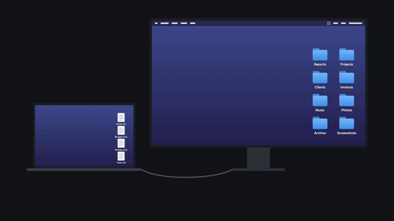
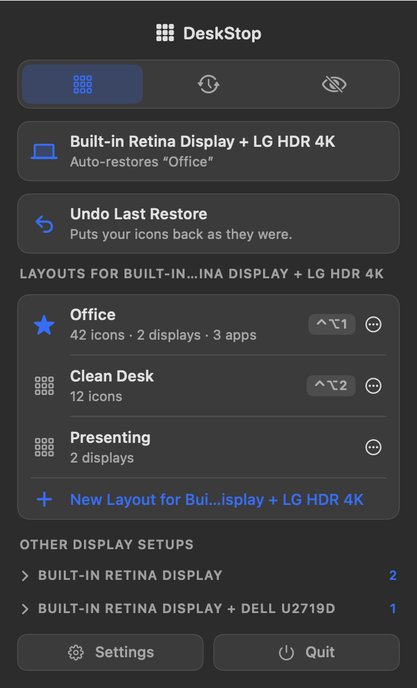
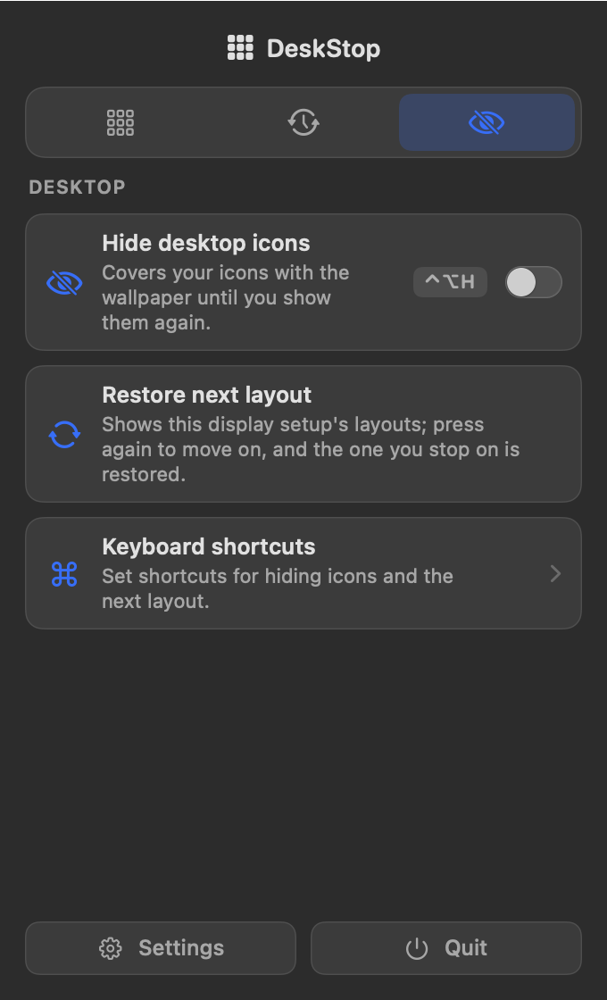
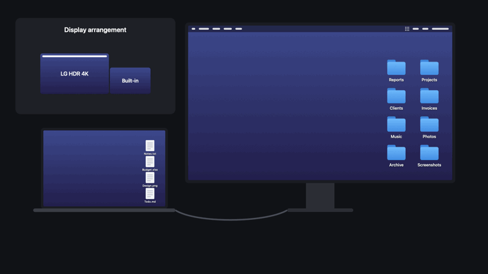
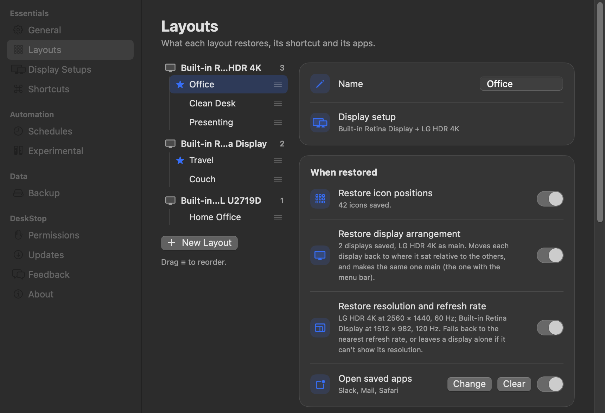
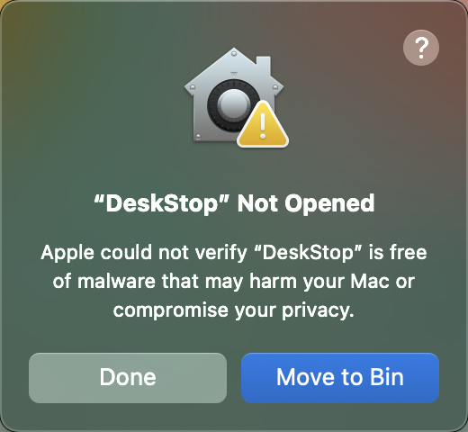
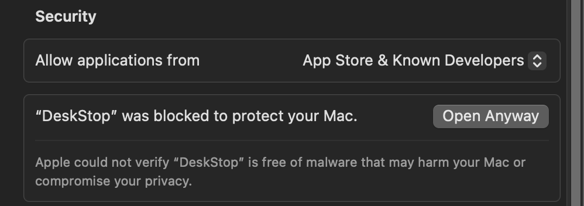

# DeskStop

**When you dock or undock your Mac from an external monitor, macOS can change which display is your main one, leaving the icons and folders on your desktop rearranged and stacked on top of each other.**

This happens when you arrange your icons yourself. If your desktop uses one of macOS's automatic options, such as Sort By Name or Tags, macOS keeps the icons in order for you, and DeskStop can't move them.

DeskStop fixes that. It's a free menu bar app that saves how your desktop is arranged for each display setup and puts it back, automatically if you want, whenever your displays change.

<p align="center">
  
</p>

<p align="center">
  
  
</p>
<p align="center"><sub>Interface design inspired by <a href="https://github.com/vorssaint/vorssaint-utils">Vorssaint</a>, the popular Mac menu bar app.</sub></p>

## What it does

<p align="center">
  
</p>

- **Layouts for each display setup.** DeskStop keeps separate layouts for each combination of displays, so your laptop-only desktop and your docked desktop stay separate.
- **Choose what a layout restores.** Icon positions, where each display sits and which is main, resolution and refresh rate, and a list of apps to open. Each one is optional.
- **Auto-restore.** Pick one layout per display setup, and DeskStop restores it when you switch to those displays.
- **Undo.** Undo Last Restore puts your icons back as they were.
- **Keyboard shortcuts.** Give any layout its own shortcut, step through the layouts for your current displays, or hide your icons.
- **Hide desktop icons.** Cover your icons with your wallpaper or a picture you choose, until you show them again.
- **Schedules.** Restore a layout on chosen days of the week or on chosen dates. A schedule runs only while its display setup is connected, and is skipped if the Mac was asleep.
- **Backup.** Export your layouts, schedules, shortcuts and settings to a file. Importing adds layouts and overwrites nothing.

Two features are still experimental, and are marked Beta in the app:

- **Hide icons while screen sharing.**
- **Restore a layout when a Focus turns on.**

<p align="center">
  
</p>

## Install

DeskStop needs macOS 14 or later, and runs on Apple silicon and Intel Macs.

### Option 1: Download the zip

1. Download `DeskStop-x.y.z.zip` from the [latest release](https://github.com/LaithShareiyat/DeskStop/releases/latest).
2. Unzip it if your browser didn't, then drag **DeskStop** into your **Applications** folder.
3. Open DeskStop. macOS blocks it the first time, because it isn't notarized by Apple (that needs a paid Apple developer account). Click **Done**.

   <p align="center"></p>

4. Open **System Settings › Privacy & Security**, scroll down to **Security**, and click **Open Anyway** next to DeskStop.

   <p align="center"></p>

5. Confirm with your password or Touch ID, then click **Open Anyway** again if macOS asks.

You only need to do this once.

### Option 2: Clone the repo

This builds the app yourself from the source code, so macOS doesn't block it. You need Xcode.

```sh
git clone https://github.com/LaithShareiyat/DeskStop.git
cd DeskStop
./Scripts/build-app.sh
cp -R build/DeskStop.app /Applications/
open /Applications/DeskStop.app
```

Either way, a short tour then walks you through saving and restoring your first layout.

## Permissions

DeskStop asks for two permissions:

- **Finder access (required).** This lets DeskStop read and move your desktop icons. macOS lists it under Privacy & Security › Automation.
- **Notifications (optional).** DeskStop uses these to tell you when a layout was restored automatically, or couldn't be.

macOS normally keeps Finder access when DeskStop updates. If it ever doesn't, DeskStop asks you to allow it again the first time the new version opens. You can also turn it back on under Settings › Permissions.

## Privacy

DeskStop has no account, analytics or tracking. Its only network activity is a once-a-day update check to GitHub, and downloading an update when you choose to install one. You can turn the check off under Settings › Updates.

Your layouts, schedules and shortcuts stay on your Mac, in `~/Library/Application Support/DeskStop/`.

The bug report and feature request buttons open a GitHub issue in your browser. They fill in your DeskStop version, macOS version, Mac model and number of displays, and nothing is sent until you submit it.

## Automation

These links work from Terminal, Raycast, Alfred, or anything else that can open a URL:

| Link | What it does |
| --- | --- |
| `deskstop://restore?name=Clean%20Desk` | Restores the layout with that name |
| `deskstop://restore?id=<uuid>` | Restores one specific layout, for when several share a name |
| `deskstop://hide-icons` | Hides your desktop icons |
| `deskstop://show-icons` | Shows them again |
| `deskstop://toggle-icons` | Switches between the two |
| `deskstop://settings` | Opens Settings |
| `deskstop://settings?page=layouts` | Opens one Settings page |

The Settings pages are `general`, `layouts`, `displays`, `shortcuts`, `schedules`, `experimental`, `backup`, `permissions`, `updates`, `feedback` and `about`.

To restore a layout when a Focus turns on, go to Settings › Experimental and click **Set Up** next to "Restore a layout when a Focus turns on". The same window gives you a ready-made link for any layout.

## Uninstall

Go to Settings › About and click **Uninstall**. This removes DeskStop and all its data from your Mac and moves the app to the Trash. Your desktop icons stay where they are. You can export a backup first under Settings › Backup.

## Feedback

Use Settings › Feedback in the app, or [open an issue](https://github.com/LaithShareiyat/DeskStop/issues). Issues are public, so leave out anything private.

## Support

DeskStop is free. If it's saved you from tidying your desktop one more time, a coffee would be very much appreciated. Thank you!

<p align="center">
  <a href="https://www.buymeacoffee.com/LaithSh"></a>
</p>

## License

Copyright © 2026 Laith Sh. Licensed under the [GNU General Public License v3.0](LICENSE).
